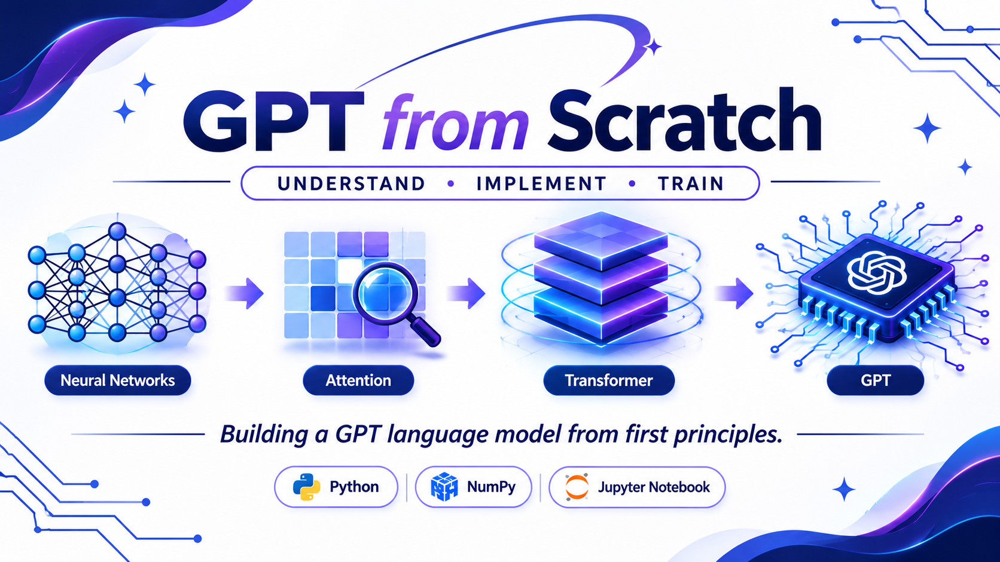

# GPT from Scratch

**Understanding, implementing, and training a GPT language model from first principles using Python and NumPy.**

## About the Project

This project explores how Large Language Models work by building a GPT-style language model from the ground up.

Instead of relying on pretrained models or deep learning frameworks for the initial implementation, I will progressively implement the fundamental components myself, understand the mathematics behind them, and train a small GPT model using randomly initialized weights.

The project follows a learning-by-building approach: each stage introduces a concept, implements it, tests it, and documents what I learn.

## Project Objectives

- Understand the mathematical foundations of neural networks.
- Implement forward and backward propagation.
- Understand and implement attention mechanisms.
- Build a Transformer architecture from scratch.
- Implement a decoder-only GPT model.
- Train the model using custom datasets.
- Evaluate model performance through experiments.
- Document implementation decisions, challenges, and findings.

## Development Roadmap

The project will be developed incrementally through the following stages.

### Stage 1: Neural Network Foundations
- Learn essential NumPy operations.
- Implement linear layers and activation functions.
- Implement forward and backward propagation.
- Build a basic neural network.
- Implement gradient descent and an optimizer.
- Verify gradients using numerical gradient checking.

### Stage 2: Language Modeling Foundations
- Understand tokenization and vocabulary.
- Convert text into numerical sequences.
- Create input-target training pairs.
- Build a simple character-level language model.
- Implement training and validation loops.

### Stage 3: Attention Mechanism
- Understand queries, keys, and values.
- Implement scaled dot-product attention.
- Apply causal masking.
- Implement multi-head attention.
- Test attention outputs and tensor dimensions.

### Stage 4: Transformer Architecture
- Implement token and positional embeddings.
- Build feed-forward networks.
- Implement layer normalization.
- Add residual connections.
- Combine components into Transformer blocks.

### Stage 5: GPT Architecture
- Build a decoder-only Transformer.
- Implement the language-modeling output layer.
- Generate text autoregressively.
- Test the complete forward pass.

### Stage 6: Training GPT from Scratch
- Prepare and process a training dataset.
- Initialize model parameters randomly.
- Train the model on a small corpus.
- Monitor training and validation loss.
- Save checkpoints and generate sample text.

### Stage 7: Evaluation and Experiments
- Measure parameter count and model size.
- Evaluate validation loss and perplexity.
- Analyze generated text.
- Experiment with model depth and embedding dimensions.
- Measure training time and memory consumption.
- Document limitations and experimental findings.

### Stage 8: Extensions
- Explore subword tokenization.
- Experiment with Bengali and English text.
- Compare character-level and subword-level modeling.
- Reimplement the model using PyTorch.
- Compare the custom implementation with the framework-based version.

## Technology Stack

| Technology | Purpose |
|---|---|
| Python | Core programming language |
| NumPy | Mathematical operations and model implementation |
| Matplotlib | Visualization and analysis |
| Jupyter Notebook | Experiments and learning |
| Git and GitHub | Version control and documentation |
| Pytest | Testing and validation |

PyTorch may be introduced later for comparison and further experiments.

## Development Philosophy

This project prioritizes understanding over simply producing code.

For every component, I aim to:

1. Understand the underlying concept.
2. Derive or study the required mathematics.
3. Implement it independently.
4. Test its correctness.
5. Investigate errors and unexpected behavior.
6. Document the solution and lessons learned.

## Hardware Constraints

Development and initial experiments will run on a CPU-based laptop with 16 GB RAM and no dedicated NVIDIA GPU.

Therefore, model sizes and datasets will be selected carefully to keep experiments feasible.

This project focuses on learning and experimentation, not training a production-scale foundation model.

## Current Status

<badge>In progress</badge>

- [ ] Neural network foundations
- [ ] Language modeling foundations
- [ ] Attention mechanism
- [ ] Transformer architecture
- [ ] GPT implementation
- [ ] GPT training
- [ ] Evaluation and experiments
- [ ] Extensions

**Long-term goal:** Build a working, small-scale GPT language model from random initialization while understanding every major component involved in its architecture and training.